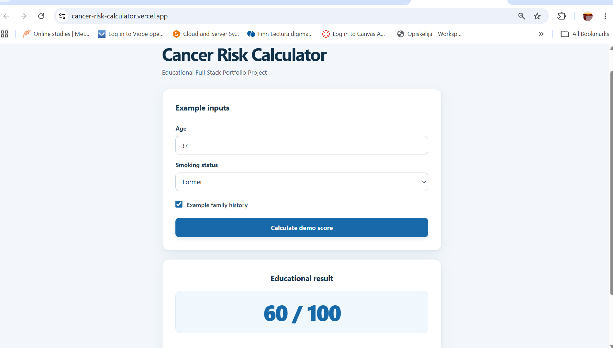
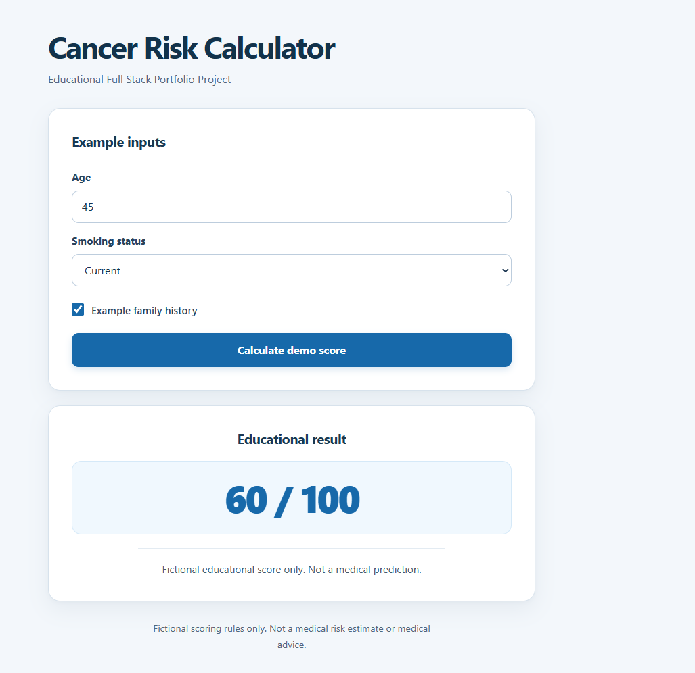
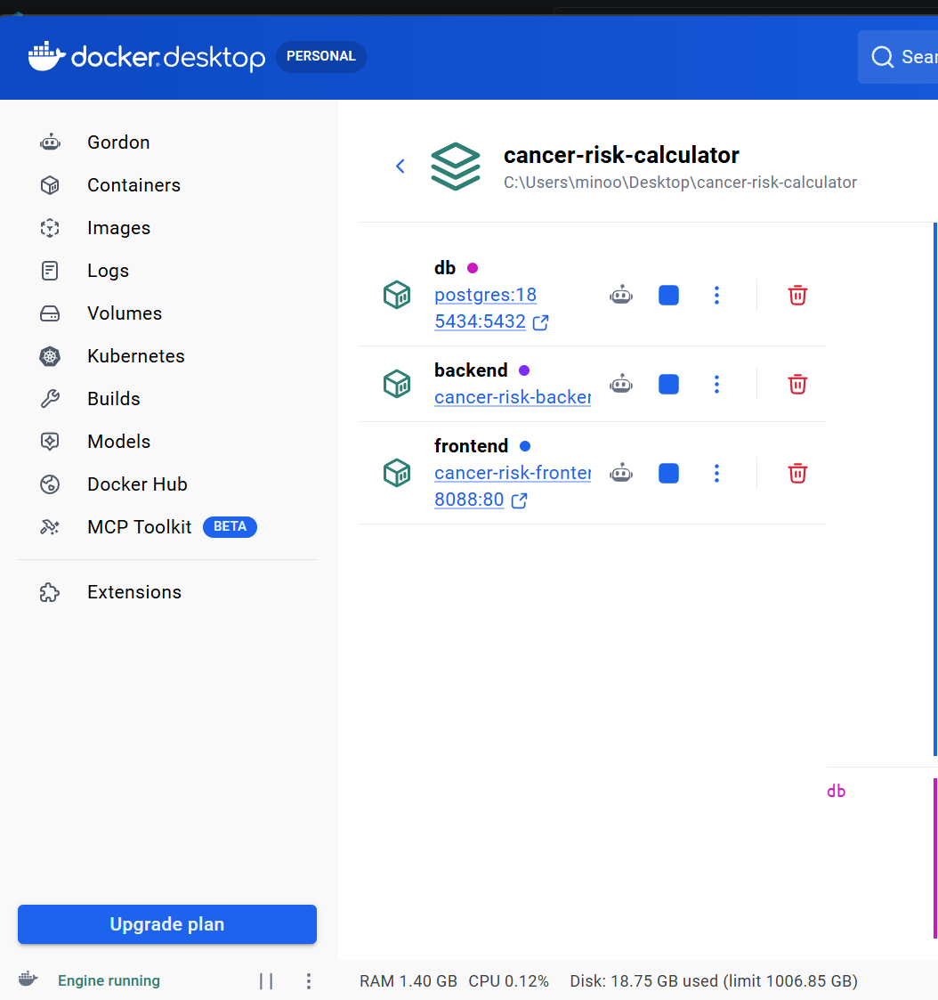
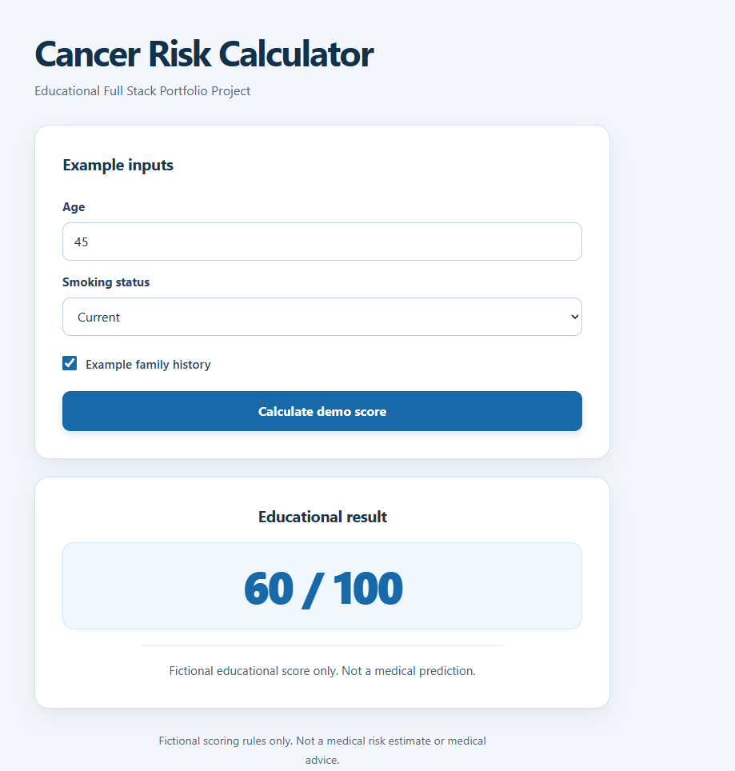
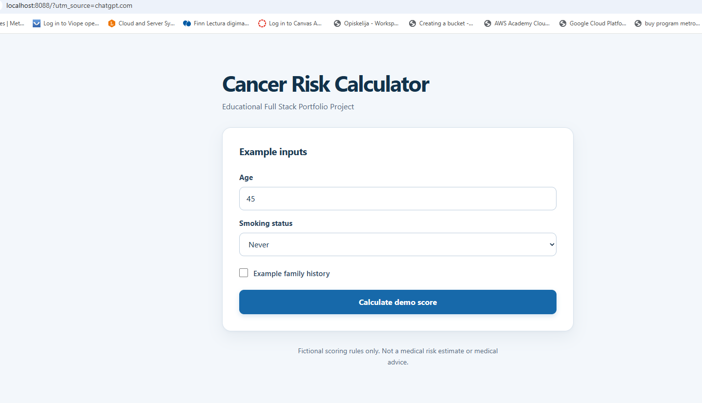

# Cancer Risk Calculator

### A small full-stack project built with purpose

[**Try the Live Demo**](https://cancer-risk-calculator.vercel.app/) · [**Explore the Source Code**](https://github.com/Minoo-YH/cancer-risk-calculator)

<p align="center">
  
</p>

## Why I Built This

I have always been interested in work where I can see a positive result from what I create, especially when technology can make everyday life a little easier for someone.

That is one reason I enjoy software development. I like taking an idea, understanding what needs to happen behind the scenes, solving problems along the way, and eventually seeing something real and usable on the screen.

I am also developing my own senior care application, which reflects my interest in creating practical digital solutions that can support people.

This Cancer Risk Calculator is a smaller portfolio project. I built it to demonstrate my full-stack development skills and my ability to take a project from a simple idea to a working, publicly deployed application.

**Important:** This application uses fictional scoring rules for educational and technical demonstration purposes only. It does not calculate actual cancer risk and must not be used for medical decisions.

## What I Can Bring to a Team

I am interested in junior full-stack development opportunities where I can contribute to real projects, continue learning, and grow alongside more experienced developers.

Through this project, I wanted to demonstrate that I can:

- Build a responsive user interface with React.
- Create REST API endpoints using Python and Flask.
- Connect backend functionality to a PostgreSQL database.
- Validate user input and handle API responses.
- Use Docker and Docker Compose to run a multi-service application.
- Work with Git and GitHub to manage project changes.
- Deploy a frontend and backend to cloud platforms.
- Troubleshoot issues across the frontend, backend, database, and deployment environment.

I enjoy independent problem-solving, but I also believe I can develop faster and contribute more effectively as part of a team. I value feedback, communication, shared responsibility, and learning from other people's experience.

## The Application

The user enters an age, selects a smoking status, and indicates whether there is an example family history.

The React frontend sends this information to the Flask API. The backend validates the input, calculates a fictional educational score, stores the calculation in PostgreSQL, and returns the result to the interface.

<p align="center">
  
</p>

The main goal was not to create a medical tool. It was to practice connecting the different parts of a real full-stack application and making them work together reliably.

## Technologies Used

| Area | Technologies |
|---|---|
| Frontend | React, JavaScript, Vite, CSS |
| Backend | Python, Flask, REST API, Gunicorn |
| Database | PostgreSQL, psycopg |
| Containerization | Docker, Docker Compose, Nginx |
| Deployment | Vercel, Render |
| Version Control | Git, GitHub |

## How the Application Works

```text
React Frontend
      |
      | HTTP / JSON
      v
Flask REST API
      |
      | Validation and demo calculation
      v
PostgreSQL Database
      |
      | Saved calculation
      v
API Response → React Result
```

The application includes two API endpoints:

| Endpoint | Purpose |
|---|---|
| `GET /api/health` | Check whether the backend is running |
| `POST /api/calculate` | Validate inputs, calculate a fictional score, and save the result |

Example request:

```json
{
  "age": 45,
  "smoking": "current",
  "family_history": true
}
```

The example returns an educational score of `60/100`.

## Docker and Local Development

I also containerized the application to practice running the frontend, backend, and database as separate services.

Docker Compose makes it possible to start and manage the services together, while Nginx serves the production frontend and forwards API requests to Flask.

### Docker Desktop

<p align="center">
  
</p>

### Running the Application with Docker

<p align="center">
  
</p>

### Application Opened from Docker

<p align="center">
  
</p>

To run the project locally, create a `.env` file in the project root with the required PostgreSQL environment variables and use:

```bash
docker compose up --build -d
```

The Docker frontend is available at:

`http://localhost:8080`

Database credentials belong in local environment configuration and are not included in the repository.

## Live Deployment

The application is deployed using separate cloud services:

- **Frontend:** Vercel
- **Backend:** Render
- **Database:** Render PostgreSQL

**Backend Health Check:** https://cancer-risk-api-eqfi.onrender.com/api/health

The live deployment was an important part of this project. I worked through configuration issues, API request validation, database setup, and deployment troubleshooting until the application worked end to end.

The free hosting services have availability and lifecycle limitations, so the live demo may occasionally take longer to respond or require maintenance.

## What I Learned

This project gave me practical experience beyond writing individual components or functions.

I learned more about how frontend and backend services communicate, how data is validated and stored, and how local development differs from a cloud deployment.

I also practiced reading error messages, investigating unexpected API responses, checking configuration, and making small changes until the complete system worked.

These are skills I want to keep improving in a professional development environment.

## Looking Forward

This is a relatively small project, but it represents the way I want to grow as a developer: by building, testing, learning, and improving.

I am especially motivated by opportunities to work on useful products, collaborate with a supportive team, and contribute to software that creates meaningful value for its users.

I know I still have a lot to learn, and that is something I genuinely look forward to.

---

**Medical Disclaimer:** The Cancer Risk Calculator is an educational software demonstration. Its score is fictional, is not based on a validated clinical risk model, and is not a diagnosis, medical assessment, or prediction.